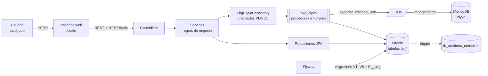

# 🐾 Clyvo PetCare

Plataforma para o **cuidado contínuo da saúde dos pets**. Hoje o histórico de um animal fica espalhado entre clínicas, papéis e a memória do tutor; o Clyvo PetCare reúne em um só lugar o **prontuário** de cada pet (dados de saúde, alergias, consultas, diagnósticos e retornos), a agenda das clínicas e os **lembretes de retorno**, para que nenhum acompanhamento se perca.

Por trás disso, o agendamento é validado no próprio banco de dados (package PL/SQL), todas as alterações de consultas são auditadas e os dados são exportados para um banco NoSQL.

Projeto desenvolvido para o **Challenge Clyvo 2026 — Sprint 4** (turma 2TDSPV, Análise e Desenvolvimento de Sistemas, FIAP).

## 👥 Integrantes

| Integrante | RM |
|---|---|
| Enzo Xavier Coelho | 563379 |
| Gustavo Ribeiro Permagnani | 564995 |
| Júlia Kauane Menezes Farias | 565568 |
| Larissa Juvenal de Magalhães | 566457 |
| Matheus Gianolli | 565258 |

## 🔗 Links

| Item | Link |
|---|---|
| Aplicação online | _preencher com a URL do deploy_ |
| Vídeo — Java Advanced | _preencher_ |
| Vídeo — Database | _preencher_ |
| Repositório | https://github.com/MatheusGianolli/Challenge-java2026 |

## 🛠️ Tecnologias

| Camada | Tecnologias |
|---|---|
| Backend | Java 17, Spring Boot 3.2, Spring Web, Spring Data JPA, Bean Validation |
| Segurança | Spring Security (HTTP Basic, perfis ADMIN e VETERINARIO) |
| Banco relacional | Oracle Database 19c, Flyway (versionamento), PL/SQL (package, trigger) |
| Banco NoSQL | MongoDB (coleções com validação `$jsonSchema` e índices) |
| Interface web | HTML, CSS e JavaScript puro, servidos pelo próprio Spring Boot |
| Documentação | SpringDoc OpenAPI / Swagger UI |
| Ferramentas | Maven, IntelliJ IDEA, Oracle SQL Developer / Data Modeler, MongoDB Compass, Git/GitHub |

## 🏗️ Arquitetura



```text
Challenge-java2026/
├── database/
│   ├── entrega/      → SQL completo e PDF dos modelos (disciplina de Database)
│   ├── json/         → coleções exportadas do Oracle (tutores, veterinarios, clinicas)
│   ├── modelagem/    → modelos lógico e físico (Data Modeler)
│   └── mongodb/      → criação, importação e consultas do MongoDB
├── src/main/java/br/com/challenge/
│   ├── config/       → segurança, CORS, cache e OpenAPI
│   ├── controllers/  → endpoints REST
│   ├── dtos/         → dados de entrada e saída
│   ├── exceptions/   → tratamento global de erros
│   ├── models/       → entidades JPA
│   ├── repositories/ → acesso a dados (JPA e package PL/SQL)
│   ├── services/     → regras de negócio
│   └── util/         → regras compartilhadas
└── src/main/resources/
    ├── db/migration/ → migrations do Flyway (V1..V5 e R__pkg_clyvo)
    ├── static/       → interface web (index.html, css, js)
    └── application.properties
```

| Camada | Responsabilidade |
|---|---|
| controllers | Recebem as requisições HTTP e devolvem as respostas |
| services | Concentram as regras de negócio |
| repositories | Acesso ao banco: JPA para o CRUD e `PkgClyvoRepository` para o package PL/SQL |
| models | Entidades persistidas |
| dtos | Contratos de entrada e saída da API |
| exceptions | Tratamento centralizado de erros (400, 404, 409) |
| util | Regras compartilhadas entre services (ex.: validação de status) |
| config | Segurança, CORS, cache e documentação |

## 🧩 Modelo de dados

| Tabela | Conteúdo |
|---|---|
| `tb_tutores` | Responsáveis pelos pets (tutor, ONG ou abrigo) |
| `tb_pets` | Animais, com dados de saúde, alergias e microchip |
| `tb_clinicas` | Clínicas e hospitais veterinários |
| `tb_veterinarios` | Profissionais, com CRMV e especialidade |
| `tb_consultas` | Tabela fato: agendamentos, diagnósticos, status e valor |
| `tb_auditoria_consultas` | Histórico de INSERT/UPDATE/DELETE em consultas (alimentada por trigger) |

Relacionamentos: um tutor possui vários pets; cada consulta liga um pet, seu responsável, uma clínica e um veterinário.

Regras de integridade no banco (migration `V5`): CRMV, CNPJ, documento do tutor e microchip únicos; campos essenciais obrigatórios; status, sexo, valor, peso e data de retorno validados por `CHECK`.

## 🗄️ Banco de dados (Oracle + PL/SQL)

O Flyway cria e versiona todo o banco ao iniciar a aplicação:

| Migration | Conteúdo |
|---|---|
| `V1__cria_tabelas.sql` | Tabelas e chaves estrangeiras |
| `V2__ajusta_tipos_numericos.sql` | Ajuste de peso e altura |
| `V3__valor_consulta_auditoria_e_comentarios.sql` | Valor da consulta, `CHECK`s, índices, tabela de auditoria e comentários |
| `V4__carga_dados.sql` | Carga inicial (5+ registros por tabela) |
| `V5__constraints_integridade.sql` | `UNIQUE`, `NOT NULL` e `CHECK`s de domínio |
| `R__pkg_clyvo.sql` | Package `pkg_clyvo` e trigger de auditoria (migration repetível) |

### Package `pkg_clyvo`

| Rotina | Tipo | Uso na aplicação |
|---|---|---|
| `agendar_consulta` | Procedure | `POST /api/consultas` — valida veterinário e clínica ativos, pet do responsável, data futura, conflito de horário e limite diário, e insere a consulta |
| `valida_limite_agenda` / `vagas_disponiveis` | Funções | `GET /api/consultas/disponibilidade` — limite de 8 consultas por dia por veterinário |
| `resumo_consultas` | Procedure (`SYS_REFCURSOR`) | `GET /api/relatorios/resumo-consultas` — faturamento por veterinário e tipo, com subtotais e total geral calculados manualmente |
| `consulta_para_json` | Função | Conversão manual de uma consulta para JSON (sem funções nativas de JSON) |
| `exportar_colecao_json` | Função (`CLOB`) | `GET /api/relatorios/exportacao/{colecao}` — gera o dataset para o MongoDB |
| `definir_usuario_aplicacao` | Procedure | Grava o usuário logado na sessão para a auditoria |
| `registrar_auditoria` | Procedure | Chamada pela trigger `trg_auditoria_consultas` |

Os erros de negócio do package (`ORA-20001` a `ORA-20012`) são convertidos pela API em respostas `404` e `409` com a mensagem do banco.

Entregáveis da disciplina em `database/entrega/`: `2TDSPV_2026_CodigoSql_Clyvo.sql` (script completo, com demonstração das rotinas e das exceções) e `2TDSPV_2026_Proj_BD.pdf` (modelos lógico e físico).

## 🍃 MongoDB

O banco `clyvo` é alimentado pelo JSON gerado no Oracle:

| Coleção | Modelagem |
|---|---|
| `tutores` | Documento do tutor com os **pets embutidos** e, em cada pet, o **histórico de consultas embutido** — a ficha completa sai em uma única leitura |
| `veterinarios` | Coleção própria (referenciada nas consultas), com estatísticas pré-calculadas |
| `clinicas` | Coleção própria, com contato e endereço como subdocumentos |

Scripts em `database/mongodb/`:

```bash
# 1. Cria as coleções com validação ($jsonSchema) e índices
mongosh "mongodb://localhost:27017" --file database/mongodb/01_criacao.js

# 2. Importa os JSON exportados do Oracle (PowerShell)
.\database\mongodb\02_importacao.ps1

# 3. Consultas de exemplo (ficha do tutor, alergias, agenda, faturamento...)
mongosh "mongodb://localhost:27017" --file database/mongodb/03_consultas.js
```

Também é possível importar pelo MongoDB Compass: coleção → **Add Data → Import JSON**.

## 🖥️ Interface web

Disponível na raiz da aplicação (`http://localhost:8080`). Telas:

- **Login** com os perfis da aplicação.
- **Painel** com indicadores, próximas consultas, **retornos previstos nos próximos 30 dias** e faturamento por veterinário.
- **Prontuário do pet**: dados de saúde, alergias em destaque, contato do responsável e linha do tempo de consultas, diagnósticos e retornos.
- **Consultas**: agendamento com verificação de vagas do veterinário, registro do atendimento (diagnóstico e retorno) e cancelamento.
- **Tutores, Pets, Clínicas e Veterinários**: listagem com busca, cadastro, edição, ativação/desativação e exclusão (conforme o perfil).
- **Relatórios**: faturamento com subtotais e exportação das coleções em JSON para o MongoDB.

## 🔐 Autenticação e perfis

Spring Security com HTTP Basic. Usuários em memória, com as senhas lidas da configuração (`app.seguranca.*` no `application.properties`), que podem ser trocadas pelas variáveis de ambiente `ADMIN_PASSWORD` e `VET_PASSWORD`. Valores padrão para avaliação:

| Usuário | Senha | Perfil | Permissões |
|---|---|---|---|
| `admin` | `admin123` | ADMIN | Acesso total |
| `veterinario` | `vet123` | VETERINARIO | Consulta e cadastro, sem exclusões e sem gerenciar veterinários |

## 🌐 Endpoints

Documentação interativa: `http://localhost:8080/swagger-ui/index.html`

| Recurso | Endpoints |
|---|---|
| Autenticação | `GET /api/me` |
| Tutores | `GET /api/tutores` · `GET /api/tutores/{id}` · `POST /api/tutores` · `PUT /api/tutores/{id}` · `DELETE /api/tutores/{id}` |
| Pets | `GET /api/pets` · `GET /api/pets/{id}` · `GET /api/pets/{id}/historico` (prontuário) · `POST /api/pets` · `PUT /api/pets/{id}` · `DELETE /api/pets/{id}` |
| Clínicas | `GET /api/clinicas` · `GET /api/clinicas/{id}` · `GET /api/clinicas/buscar?nome=` · `GET /api/clinicas/buscar/cidade?cidade=` · `POST` · `PUT /{id}` · `PATCH /{id}/status` · `DELETE /{id}` |
| Veterinários | `GET /api/veterinarios?especialidade=` · `GET /{id}` · `POST` · `PUT /{id}` · `PATCH /{id}/status?status=` · `DELETE /{id}` |
| Consultas | `GET /api/consultas` · `GET /{id}` · `GET /api/consultas/retornos?dias=30` · `GET /api/consultas/disponibilidade?veterinarioId=&data=` · `POST /api/consultas` · `PUT /{id}/diagnostico?diagnostico=&retorno=` · `DELETE /{id}` (cancelamento) |
| Relatórios | `GET /api/relatorios/resumo-consultas?inicio=&fim=` · `GET /api/relatorios/exportacao/{TUTORES\|VETERINARIOS\|CLINICAS}` |

Listagens com paginação e ordenação (`?page=0&size=10&sort=nome`).

## ▶️ Como executar

**Pré-requisitos:** Java 17+, Maven (ou o Maven Wrapper do projeto) e acesso a um Oracle Database. MongoDB é opcional (apenas para a parte NoSQL).

```bash
git clone https://github.com/MatheusGianolli/Challenge-java2026.git
cd Challenge-java2026
```

Defina as credenciais do Oracle como variáveis de ambiente (elas não ficam no código):

```powershell
# Windows (PowerShell)
$env:DB_USERNAME="seu_usuario"
$env:DB_PASSWORD="sua_senha"
.\mvnw.cmd spring-boot:run
```

```bash
# Linux / macOS
export DB_USERNAME=seu_usuario
export DB_PASSWORD=sua_senha
./mvnw spring-boot:run
```

No IntelliJ: **Run → Edit Configurations → Environment variables** → `DB_USERNAME=...;DB_PASSWORD=...`.

Ao subir, o Flyway cria as tabelas, carrega os dados e compila o package. Depois acesse:

- Interface: `http://localhost:8080`
- Swagger: `http://localhost:8080/swagger-ui/index.html`

## 🧪 Testes

- Endpoints testados pelo Swagger e pelo Postman (coleção em `documentos/`).
- Rotinas PL/SQL testadas pelo script `database/entrega/2TDSPV_2026_CodigoSql_Clyvo.sql` (parte 7: execução e exceções).
- Consistência Oracle → MongoDB: o faturamento por veterinário calculado no Mongo (`03_consultas.js`) é igual ao da procedure `resumo_consultas`.

## 🤝 Integração com as demais disciplinas

Cada integrante documentou como a sua disciplina se integra ao projeto em `docs/integracao/`:

| Disciplina | Resumo | Detalhes |
|---|---|---|
| Mastering Relational and Non-Relational Database | Mesmo banco Oracle da aplicação, package `pkg_clyvo` chamado pela API, trigger de auditoria, exportação JSON e MongoDB | [database.md](docs/integracao/database.md) |
| DevOps Tools & Cloud Computing | Banco em nuvem, deploy e pipeline de CI/CD | [devops.md](docs/integracao/devops.md) |
| Mobile Application Development | Aplicativo do tutor | [mobile.md](docs/integracao/mobile.md) |
| Disruptive Architectures: IoT, IoB & Generative AI | IA apoiada no histórico clínico dos pets | [ia.md](docs/integracao/ia.md) |
| Compliance, Quality Assurance & Tests | Plano de testes e automação sobre as regras de negócio | [qa.md](docs/integracao/qa.md) |
