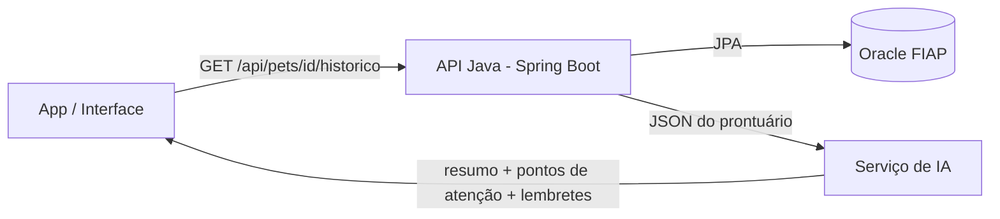

# IA no Clyvo — resumo do prontuário a partir da API Java

A IA não acessa o banco diretamente. Ela consome o prontuário consolidado que a API Java já monta em
`GET /api/pets/{id}/historico` e transforma esses dados em um resumo para o veterinário e em lembretes para o tutor.

## Fluxo



## Entrada (exemplo da resposta da API)

```json
{
  "pet": {
    "id": 1,
    "nome": "Thor",
    "especie": "Cachorro",
    "raca": "Labrador",
    "dataNascimento": "2019-05-10",
    "peso": 32.5,
    "porte": "GRANDE",
    "statusSaude": "EM_TRATAMENTO",
    "alergias": "Dipirona",
    "nomeResponsavel": "Ana Paula Ferreira"
  },
  "totalConsultas": 3,
  "consultasRealizadas": 2,
  "ultimoAtendimento": "2026-10-20T10:00:00",
  "proximaConsulta": null,
  "proximoRetorno": "2026-11-03T00:00:00",
  "consultas": [
    { "dataPrevista": "2026-10-20T10:00:00", "tipoConsulta": "ROTINA", "status": "REALIZADA",
      "diagnostico": "Otite externa no ouvido esquerdo. Prescrito antibiótico tópico por 10 dias." }
  ]
}
```

## Prompt usado

```text
Você é um assistente de uma clínica veterinária. Com base no prontuário em JSON abaixo:
1. Resuma em até 3 frases a situação de saúde do pet.
2. Liste os pontos de atenção (alergias, tratamento em andamento, retorno atrasado ou próximo).
3. Escreva uma mensagem curta e gentil para lembrar o tutor do próximo passo.
Não invente informações que não estejam no JSON.

PRONTUÁRIO:
{json_do_historico}
```

## Saída esperada (exemplo)

- **Resumo:** Thor, labrador de 7 anos, está em tratamento de uma otite externa diagnosticada em 20/10.
- **Pontos de atenção:** alérgico a dipirona; retorno para reavaliar a otite previsto para 03/11.
- **Mensagem ao tutor:** "Oi, Ana! O retorno do Thor para reavaliar o ouvido é em 03/11. Quer confirmar o horário?"

## Por que essa integração

O valor da Clyvo é o **cuidado contínuo**: o histórico do pet fica num só lugar. A IA aproveita esse histórico
para que nenhum retorno se perca e para que o veterinário tenha o contexto do pet em segundos.
